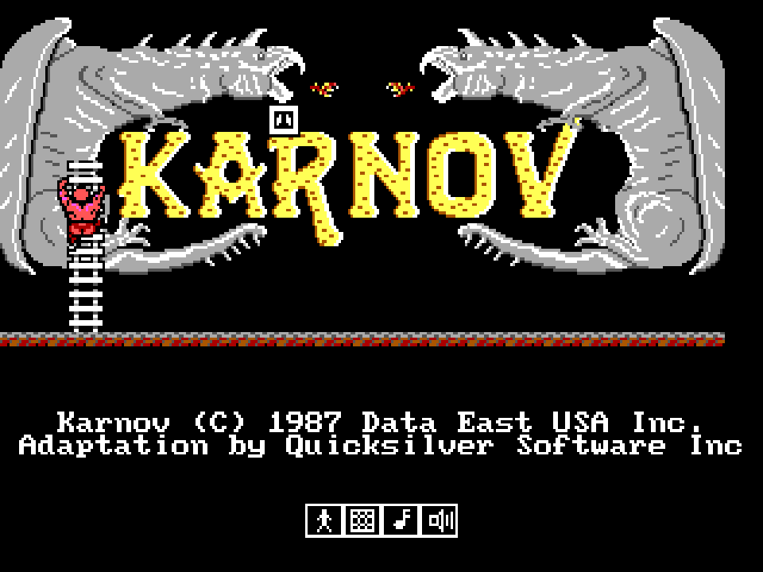
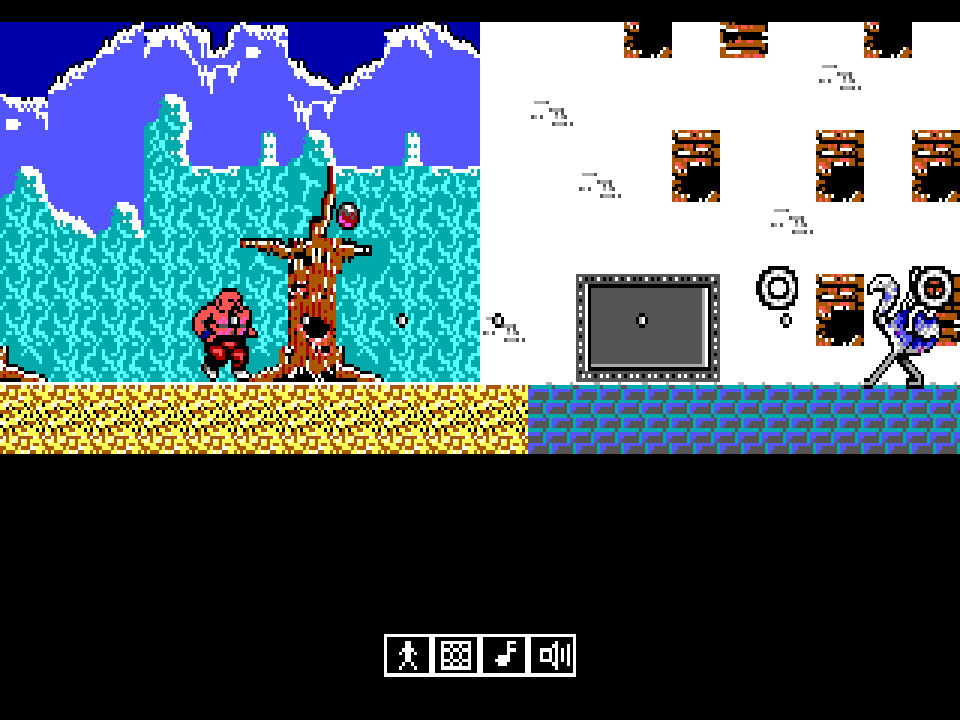

# Karnov — порт DOS-версии на C99 + SDL2

Неофициальный порт **Karnov** (Data East USA, 1987; DOS-адаптация
Quicksilver Software) на современные системы. Это не ремейк и не
реконструкция «по смыслу»: `KARNOV.EXE` переведён на Си функция в
функцию, а то, что оригинал делал портами и BIOS (видеоадаптеры,
таймер, PC-speaker, клавиатура, джойстик), эмулируется поверх SDL2.

<p align="center">
  
  
</p>

## Возможности

- Все 9 уровней, демо-режим, таблица рекордов — поведение оригинала.
- Видеорежимы EGA, CGA, Tandy и Hercules (меню `--menu`, как Shift при
  запуске оригинала).
- Музыка и эффекты PC-speaker.
- Клавиатура как в оригинале, джойстик — через геймпад SDL.
- Постоянный темп, не зависящий от скорости машины.

## Файлы игры

Данных игры в репозитории нет. Нужны файлы DOS-версии Karnov:

```
LEVEL0.BIN … LEVEL9.BIN
LEVEL0.MOV  LEVEL1.MOV  LEVEL2.MOV
SPRITES.EGA SPRITES.CGA
```

Регистр имён не важен. Игра ищет их в текущем каталоге.

## Сборка и запуск

Нужны gcc (или clang), make и SDL2 с заголовками
(`libsdl2-dev` / `SDL2-devel`).

```bash
cd karnov_c
make karnov
cd /путь/к/файлам/игры
/путь/к/karnov_c/karnov
```

| Опция | Действие |
|---|---|
| `--menu` | меню видеорежима: CGA, EGA, Tandy, Hercules |
| `--no-audio` | без звука |
| `--fps N` | темп в кадрах/с (по умолчанию ≈18; `0` — максимум оригинала, ≈27) |
| `--headless`, `--fast`, `--frames N` | для автоматических прогонов: без окна, без выдержки времени, выход после N кадров |

После загрузки уровня доигрывает музыка загрузчика (≈14 с) — её
прерывает любая клавиша или кнопка геймпада.

## Управление

| Клавиша | Действие |
|---|---|
| Стрелки / цифровой блок | направление (5 — стоп; направление «залипает», как в оригинале) |
| Пробел или X | огонь |
| Z | предмет |
| Enter | начать игру |
| Esc | пауза |
| Q | выход |
| 1–4 | два игрока, джойстик, музыка, эффекты |

**Геймпад.** Клавиша 2 включает режим джойстика и калибрует центр — стик
в этот момент должен быть отпущен. Левый стик или крестовина —
направление, A/X — огонь, B/Y — предмет; в демо кнопка начинает игру.

**Чит-код** (в мануале его нет, найден при декомпиляции): Ctrl+Z,
Ctrl+E, Ctrl+E, Ctrl+K — «ZEEK». Даёт неуязвимость, быструю стрельбу и
выбор уровня: L и цифра 0–9. Сбрасывается при начале новой игры.

## Устройство

```
karnov_c/
├── src/orig/      перевод KARNOV.EXE
│   ├── sSSSS_*.c  модули оригинала по сегментам; у каждой функции тег
│   │              @SEG:OFF file:FFFFF — её адрес в KARNOV.EXE
│   ├── ds.c       глобалы сегмента данных с начальными значениями
│   ├── hw*.c      порты и BIOS: видео, PIT и динамик, клавиатура,
│   │              джойстик, детект машины
│   └── main.c     опции и события SDL
├── src/old/       прежний порт-реконструкция (make karnov_old)
├── src/platform/  общий код: открытие файлов, палитры, спрайты
└── tools/         скрипты анализа EXE
```

Где оригинал читает память за пределами массивов (мусор, зависящий
от DOS и порядка загрузки), перевод использует определённые правила —
см. [karnov_c/README.md](karnov_c/README.md).

## Документация

- [karnov_c/README.md](karnov_c/README.md) — сборки, опции, устройство перевода
- [KARNOV.md](KARNOV.md) — устройство `KARNOV.EXE` и форматы файлов данных
- [AUDIO.md](AUDIO.md) — звуковая подсистема (PC-speaker, музыка, эффекты)
- [docs/DECOMPILATION.md](docs/DECOMPILATION.md) — как велась декомпиляция
- [docs/DECOMPILE_NOTES.md](docs/DECOMPILE_NOTES.md) — карта адресов `KARNOV.EXE`
- [docs/ENEMY_GUIDE.md](docs/ENEMY_GUIDE.md) — каталог всех 57 типов врагов

## Правовая информация

Karnov © 1987 Data East USA Inc.; DOS-адаптация — Quicksilver Software
Inc. Проект неофициальный, не связан с правообладателями и не содержит
файлов игры: для запуска нужна своя копия DOS-версии.
